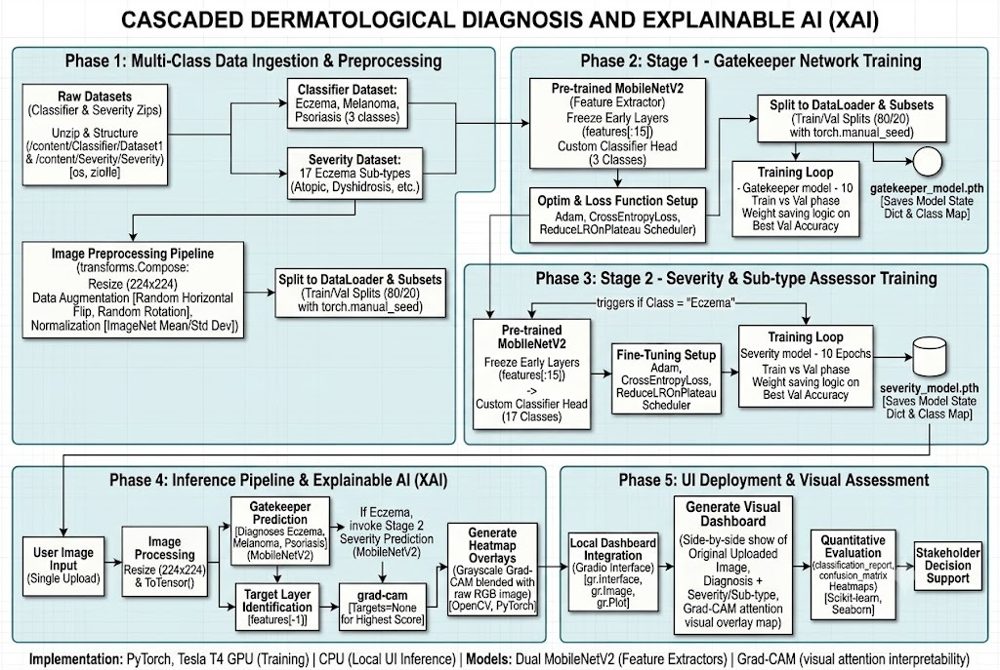

#  Brain Tumor Segmentation Using U-Net and PyTorch

A deep learning project that performs automated brain tumor segmentation from MRI images using a U-Net architecture implemented from scratch in PyTorch.

The model takes an MRI image as input and generates a pixel-level segmentation mask highlighting the tumor region.

## Project Overview

Brain tumor segmentation is an important task in medical image analysis. Manually identifying tumor regions in MRI scans can be time-consuming and requires specialized expertise.

This project explores the use of deep learning and semantic segmentation to identify tumor regions in brain MRI images using a U-Net architecture.

The model is trained using PyTorch with a combination of Binary Cross-Entropy and Dice Loss to improve segmentation performance.

##  Features

- U-Net architecture implemented from scratch using PyTorch.
- MRI image preprocessing and normalization.
- Binary tumor segmentation at pixel level.
- Combined BCE and Dice Loss for model optimization.
- GPU-accelerated training using CUDA.
- Evaluation using Dice Score and Intersection over Union (IoU).
- Visualization of predicted segmentation masks against ground-truth masks.

##  Tech Stack

| Category | Technologies |
|---|---|
| Language | Python |
| Deep Learning | PyTorch |
| Numerical Computing | NumPy |
| Data Processing | h5py |
| Visualization | Matplotlib |
| Hardware Acceleration | CUDA |
| Development | Jupyter Notebook |

##  Dataset

The project uses the **BraTS 2D MRI Segmentation dataset**, obtained from Hugging Face.

Dataset characteristics:
- Original MRI images stored in HDF5 (`.h5`) format.
- Image dimensions: 240 × 240 pixels.
- Original mask values: `[0, 50, 100, 150]`.
- Total processed image slices: 4,715.
- Images resized to 128 × 128 for training.

### Dataset Split

| Split | Images |
|---|---:|
| Training | 3,272 |
| Validation | 675 |
| Testing | 768 |
| **Total** | **4,715** |

The dataset was preprocessed and divided into training, validation, and testing subsets.

##  Model Architecture

The project implements the original U-Net encoder-decoder architecture.

U-Net consists of two main paths:

**1. Encoder (Contracting Path)**
- Extracts spatial features from MRI images.
- Uses repeated 3×3 convolutions.
- Applies Batch Normalization and ReLU activation.
- Uses Max Pooling for downsampling.

**2. Decoder (Expanding Path)**
- Reconstructs spatial information.
- Uses transposed convolutions for upsampling.
- Incorporates skip connections from the encoder.
- Produces pixel-level segmentation predictions.

### Architecture Flow



The model outputs raw logits during training. Sigmoid is applied during probability calculation and prediction.

##  Training Configuration

| Parameter | Value |
|---|---|
| Framework | PyTorch |
| Architecture | U-Net |
| Input Size | 128 × 128 × 1 |
| Batch Size | 16 |
| Epochs | 30 |
| Optimizer | Adam |
| Learning Rate | 0.0001 |
| Loss Function | BCE + Dice Loss |
| Hardware | NVIDIA RTX 5050 Laptop GPU |

### Loss Function

A combination of two loss functions is used:

**Binary Cross-Entropy Loss (BCE):** Measures pixel-level classification error.

**Dice Loss:** Measures the overlap between predicted segmentation masks and ground-truth masks.

The combined objective is:

```text
Total Loss = BCE Loss + Dice Loss
```

##  Model Performance

The trained model was evaluated using Dice Score and Intersection over Union (IoU).

### Validation Results

| Metric | Score |
|---|---:|
| Dice Score | 93.10% |
| IoU | 87.32% |

### Test Results

| Metric | Score |
|---|---:|
| Dice Score | **89.63%** |
| IoU | **81.82%** |

The test results represent evaluation on the held-out test split.

##  Project Structure

```text
AISA-Project/
│
├── README.md
├── .gitignore
├── requirements.txt
├── dataset_link.txt
├── arch.jpeg
│
├── notebooks/
│   ├── Aisa_Miniproject.ipynb
│   └── AISA_MINIPROJECT.ipynb
│
├── src/
│   ├── gatekeeper.py
│   ├── classifier.py
│   └── severity.py
│
├── models/
│   └── README.md
│
└── docs/
    └── research_reference.md
```

## Getting Started

### 1. Clone the Repository

### 2. Create a Virtual Environment

```bash
python -m venv venv
```

Activate it:

**Windows:**
```bash
venv\Scripts\activate
```

**Linux/macOS:**
```bash
source venv/bin/activate
```

### 3. Install Dependencies

```bash
pip install numpy matplotlib h5py jupyter
```

Install the appropriate PyTorch build for your hardware from the official PyTorch installation guide.

### 4. Prepare the Dataset

Download the dataset from Hugging Face and run the preprocessing workflow to generate the required training, validation, and testing arrays.
```

### 5. Run the Notebook

```bash
jupyter notebook
```

Open `02_unet_training.ipynb` to train and evaluate the model.

##  Future Improvements

- Interactive web interface using Gradio or Streamlit.
- MRI upload and real-time segmentation.
- Improved visualization using colored segmentation overlays.
- Patient-level dataset splitting and evaluation.
- Experimentation with different U-Net configurations.

##  Disclaimer

This project is developed for educational and research purposes. It is not intended to provide clinical diagnoses or replace professional medical evaluation.

##  Author

**Agastya Gupta**

B.Tech  Computer Science and Engineering

---